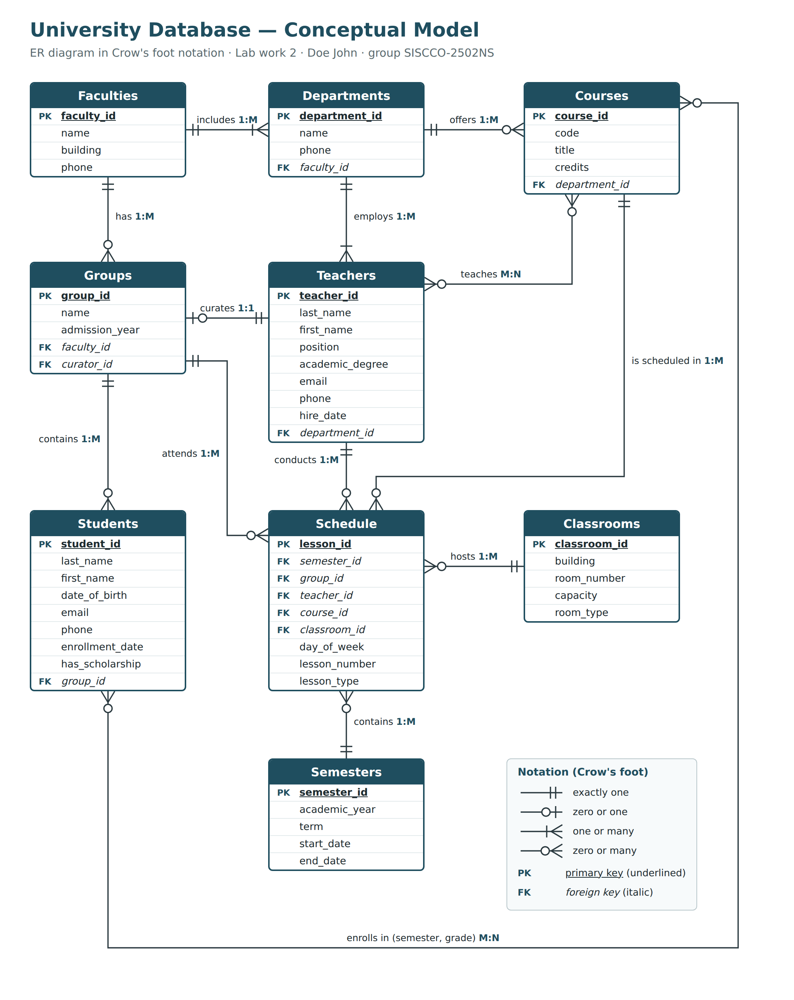

# Lab work 2 — Conceptual Design (University database)

**Goal:** the second step of database design — the ER diagram of the University database in Crow's foot notation, based on the description from Lab work 1.

**Upload:** [`Lab2_Conceptual_ER_Diagram.png`](Lab2_Conceptual_ER_Diagram.png)

The diagram contains everything the assignment requires:

- **all entities** — the 9 entities from Lab work 1;
- **all attributes** — primary keys (PK, underlined) for every entity and foreign keys (FK, italic) where needed;
- **all relationships with their types** written on each line — 1:1 (Teachers *curates* Groups), 1:M (ten relationships) and M:N (Students *enrolls in* Courses, Teachers *teaches* Courses);
- **Crow's foot notation** at both ends of every line (minimum and maximum cardinality), with a legend in the corner.

The M:N relationships are left as they are at this conceptual stage; Lab work 3 resolves them.
