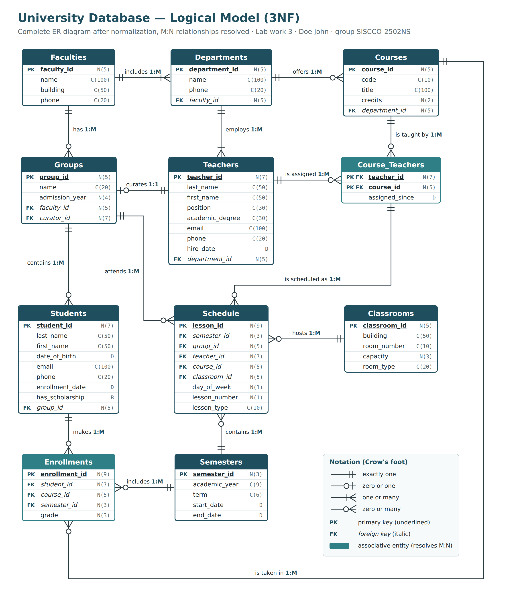

# Lab work 3 — Logical Design (University database)

**Goal:** translate the conceptual model from Lab work 2 into a logical model in third normal form, with supporting documentation.

**Upload:** [`Lab3_Logical_Design.docx`](Lab3_Logical_Design.docx) (the diagram is also included separately as [`Lab3_Logical_ER_Diagram_3NF.png`](Lab3_Logical_ER_Diagram_3NF.png))

## What changed since Lab work 2

1. **Students – Courses (M:N)** became the table **Enrollments** (student, course, semester, grade); the semester became a foreign key to Semesters.
2. **Teachers – Courses (M:N)** became the table **Course_Teachers** with the composite primary key (teacher_id, course_id).
3. **Schedule** now references Course_Teachers through one composite foreign key (teacher_id, course_id), so a teacher can only be scheduled for a course they actually teach.

Result: 11 tables, only 1:1 and 1:M relationships.

## What the report contains

- the complete ER diagram in 3NF;
- the 1NF → 2NF → 3NF check, with a summary table for all 11 tables;
- the full functional dependencies of every table, in the format `{stud_id} -> {fname, lname, dob, group_id}`;
- a description of every table in the required format: *Field's name / Field's content / Type, length (N, C, D, B) / Note (constraints)*.
