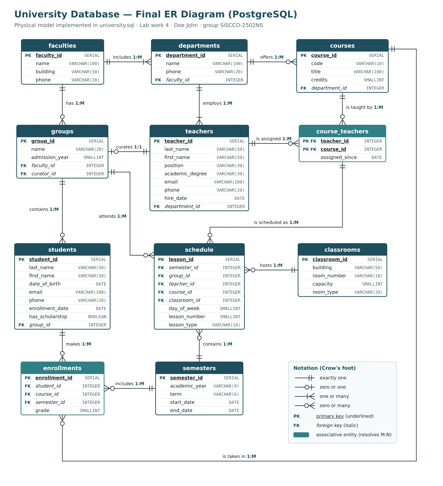

# Lab work 4 — Physical Design, SQL DDL (University database)

**Goal:** implement the logical model from Lab work 3 in PostgreSQL.

**Upload:** [`university.sql`](university.sql) + [`Lab4_Final_ER_Diagram.jpg`](Lab4_Final_ER_Diagram.jpg)

## Tasks in `university.sql`

| Task | Statement(s) |
|---|---|
| 1. Create the database | `CREATE DATABASE university;` |
| 2. Create all tables (min. 7) | 11 × `CREATE TABLE`, in dependency order |
| 3. Test table + ALTER TABLE | `test_table`: add a column, rename a column, change a type, set a default and NOT NULL, add a CHECK, rename the table |
| 4. DROP TABLE | `DROP TABLE test_table_renamed;` |

Every constraint from Lab work 3 is implemented and named (`pk_`, `fk_`, `uq_`, `ck_` prefixes): primary keys, foreign keys (including the composite key from Schedule to Course_Teachers), NOT NULL, UNIQUE and CHECK.

## How to run

- **psql:** `psql -U postgres -f university.sql`
- **pgAdmin:** run the `CREATE DATABASE` statement on its own, then open a Query Tool on the new `university` database and run the rest of the script (skip the `\c university` line — it is a psql command).

## Verification

The script was run end to end on PostgreSQL 16 with no errors. A separate test (not part of the upload) inserted valid sample data and then 24 invalid rows — every one was rejected by exactly the intended constraint, e.g. a grade of 101, a second curator role for the same teacher, a student born before 1980, or a lesson for a teacher who is not assigned to that course.
