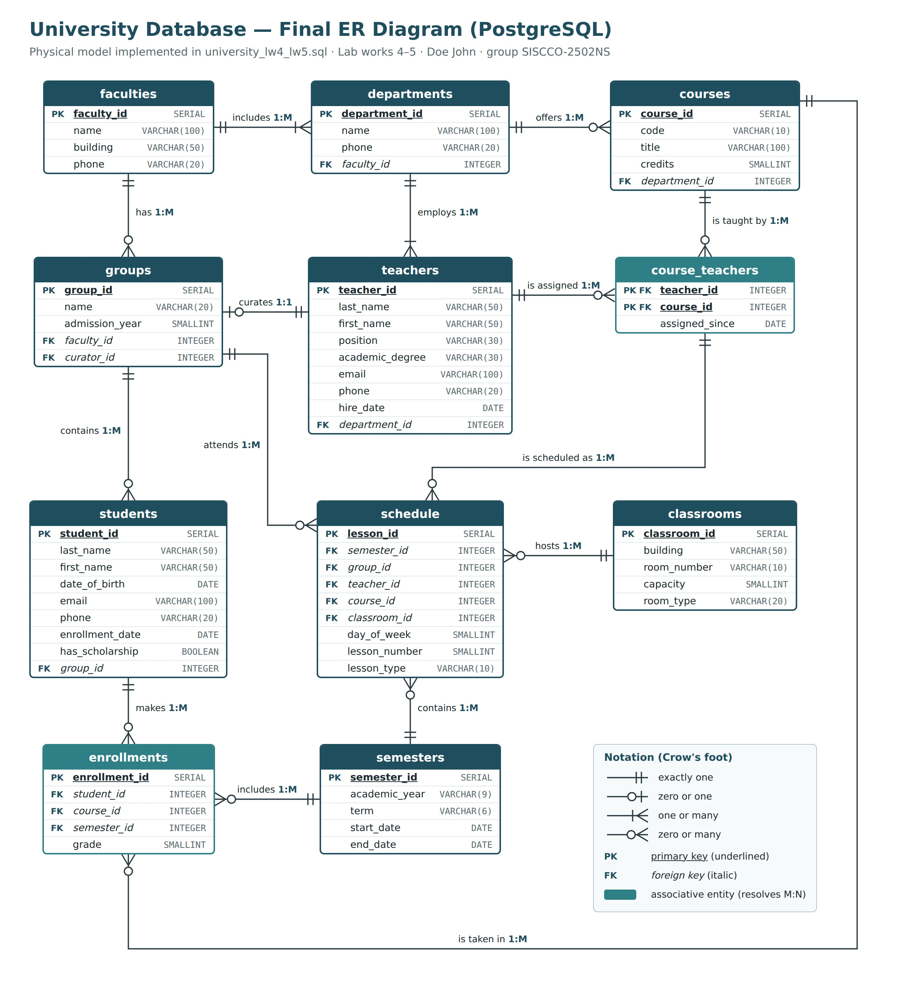

# Lab work 5 — Content, SQL DML (University database)

**Goal:** fill the University database from Lab work 4 with data and practise INSERT, UPDATE and DELETE in PostgreSQL.

**Upload:** [`university_lw4_lw5.sql`](university_lw4_lw5.sql) (Lab Work 4 + Lab Work 5 in one file) + [`Lab5_Final_ER_Diagram.jpg`](Lab5_Final_ER_Diagram.jpg)

## Structure of the SQL file

The file follows the structure required by the assignment:

| Section | Content |
|---|---|
| `-- Lab Work 4` / `-- Task 1` | `CREATE DATABASE university` |
| `-- Task 2` | 11 × `CREATE TABLE` with all constraints |
| `-- Task 3` | test table + `ALTER TABLE` |
| `-- Task 4` | `DROP TABLE` |
| `-- Lab Work 5` / `-- Task 1` | `INSERT` into every table, at least 3 rows each |
| `-- Task 2` | `UPDATE`: a student's grade changes from 48 to 61 after a retake |
| `-- Task 3` | `DELETE`: a student's enrollment in a course is removed after withdrawal |

## Data inserted

| Table | Rows | Examples |
|---|---|---|
| faculties | 3 | Information Technology, Business and Economics, Engineering |
| departments | 4 | Computer Engineering, Information Systems, Economics, Electrical Engineering |
| teachers | 6 | professors, lecturers and an assistant across the departments |
| groups | 3 | SISCCO-2502NS, SIS-2401, ECON-2501 — each with its own curator |
| students | 7 | Doe John and classmates, spread over the three groups |
| courses | 4 | Database Management Systems, Programming Fundamentals, Information Systems Analysis, Microeconomics |
| semesters | 3 | Fall 2024, Spring 2025, Fall 2025 |
| classrooms | 3 | a computer lab, a lecture hall, a seminar room |
| course_teachers | 6 | e.g. DBMS: Smith (lectures) and Brown (labs) |
| enrollments | 11 | grades from 48 to 94, one not graded yet |
| schedule | 6 | the Fall 2025 timetable of all three groups, with no clashes |

All rows respect every constraint from Lab work 4. The ER diagram is unchanged from Lab work 4 (the schema did not need corrections); only its caption now refers to Lab works 4–5.

## Verification

The whole file was run end to end on PostgreSQL 16 with no errors: every INSERT added its rows, the UPDATE and the DELETE each affected exactly one row, and a join over schedule, groups, courses, teachers and classrooms returned the expected timetable for SISCCO-2502NS.
